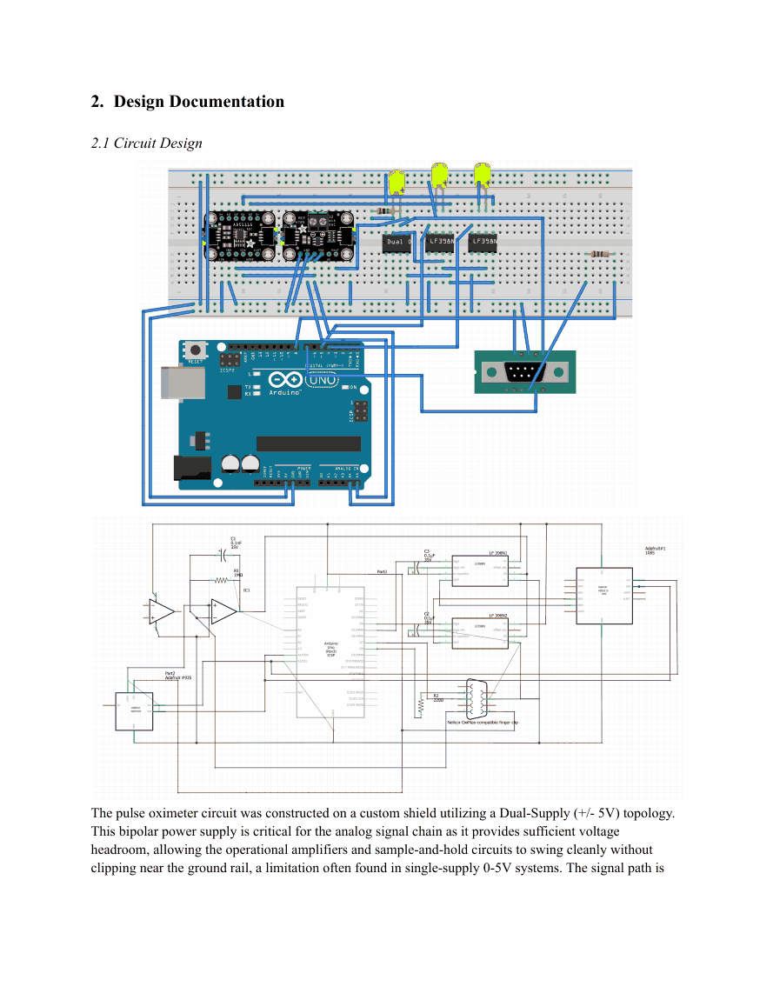
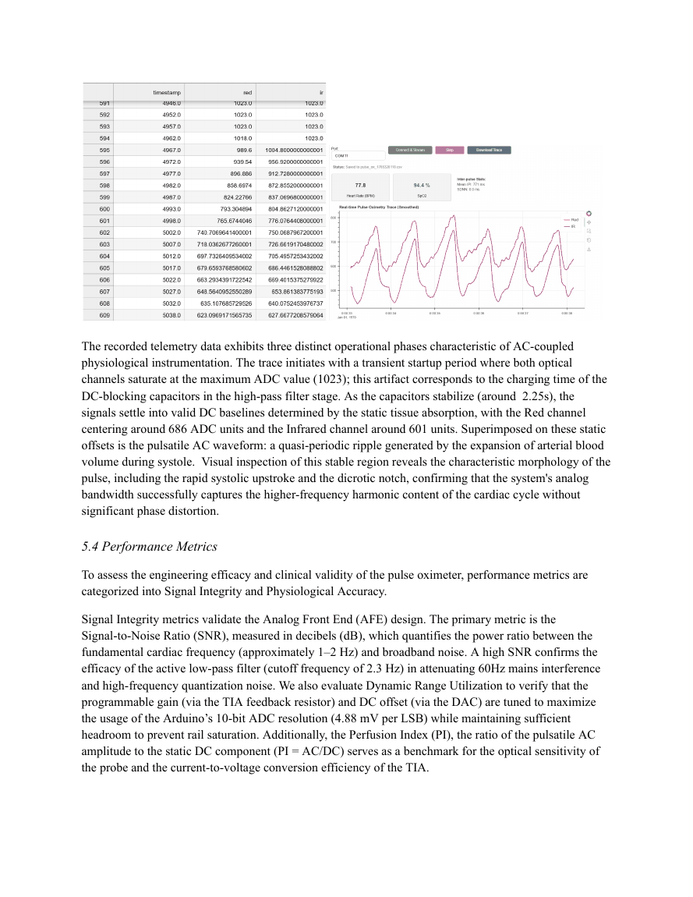

# Pulse oximeter

A Caltech **BE/EE/MedE 189a** project, as identified in the supplied write-up.

Red/infrared photoplethysmography with an Arduino acquisition loop, a Bokeh notebook dashboard and offline analysis. The [write-up](Pulse%20Oximeter%20Write-Up.pdf), by Gabo Zhang, describes a later analog/digital architecture than the separately supplied sketch. Those versions must not be treated as interchangeable.

## Optics and analog circuit

The report specifies a Nellcor OxiMax-compatible probe with 660 nm red and 940 nm infrared illumination. A photodiode feeds a transimpedance amplifier referenced to an MCP4725 DAC; shifting this reference adjusts the baseline. The report uses ±5 V analog supplies, a 1 MΩ feedback resistor and 100 pF parallel capacitor (about 1.6 kHz pole). The reported later design demodulates the two wavelengths with **two LF398 sample-and-hold circuits** and digitizes with an **ADS1115 16-bit ADC**.



## Supplied firmware: `pulse_oximeter.ino`

Renamed from `Pulse_Oximetey.ino`; code unchanged. This version uses **one shared LF398 track/hold control on D4 and the Arduino's internal ADC on A0**, not ADS1115 acquisition. D7 drives red and D8 drives infrared. Setup opens serial at 115200 baud, initializes the MCP4725 at I²C address 0x62, sets its reference code to 2048, and blocks until at least one host byte arrives. DAC discovery failure prints an error and halts.

For each wavelength the loop selects its LED, waits 100 µs, tracks for 2 ms, enters hold, turns off the LED and reads A0. It sends `millis,red_adc,ir_adc` as one CSV line, with the timestamp captured before both sequential measurements. There is no fixed sample-period scheduler, ambient-dark subtraction or continuous command parser. The two channels are sampled sequentially, not simultaneously. A single host handshake starts it; closing the port does not itself command the firmware to stop sampling.

## Python processing

* `Dashboard.ipynb`: PySerial auto-detection/manual port, two-byte handshake, Bokeh connect/stop/export controls and a 50 ms host callback. An exponential moving average with α = 0.1 smooths both traces **before plotting and recording**. The last 400 samples feed analysis; fewer samples yield zero metrics. `find_peaks` on IR uses prominence 0.5 × standard deviation and minimum distance 12 samples. Inter-peak intervals are retained only between 300 and 2000 ms; BPM = 60000 / mean interval, with interval standard deviation also displayed. Distance in samples is not a fixed duration when acquisition timing changes.
* `Evaluation.ipynb`: reads a saved `pulse_ox_1764746449.csv`, removes railed samples, reports timestamp differences/jitter, settling time, peak-derived BPM, AC/DC metrics and rolling-mean residual SNR. This CSV was not supplied. Dashboard exports contain smoothed rather than untouched ADC traces, so their downstream metrics depend on that filter.

Both use DC = channel mean and AC = channel standard deviation:

```text
R = (AC_red / DC_red) / (AC_ir / DC_ir)
SpO2 estimate = 110 - 25 R
```

These are empirical estimates, not a clinical calibration or medical validation. The dashboard checks DC and IR AC denominators; the evaluation's guard is less complete. No new safety/error handling was added to the archived code.

## Recorded results, not rerun measurements

Saved `Evaluation.ipynb` output reports 70.1 BPM, 92.0% SpO2, R = 0.721, red/IR SNR 16.59/20.74 dB, settling 2.25 s, nominal sampling-frequency calculation 474.75 Hz and jitter 408.892 ms. The large jitter and inconsistencies with the supplied sketch's ≥4.2 ms delays mean that frequency is not a demonstrated stable acquisition rate for this sketch. The write-up itself discusses serial timing limitations; no independent ground-truth comparison is supplied here.



## Running and missing inputs

The sketch implies Arduino support with Wire and Adafruit MCP4725 libraries. Use an Arduino sketch folder matching the sketch basename when importing it into the IDE. The board/analog circuit must match the **supplied sketch**, not blindly the later ADS1115 design. The notebooks import NumPy, pandas, SciPy, PySerial and Bokeh in Jupyter and use `localhost:8888` for notebook embedding. Versions are not pinned. Hardware, CSV data and a reproducible calibration are absent; neither firmware compilation nor live dashboard execution was performed here.
